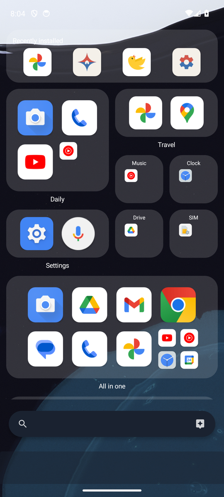
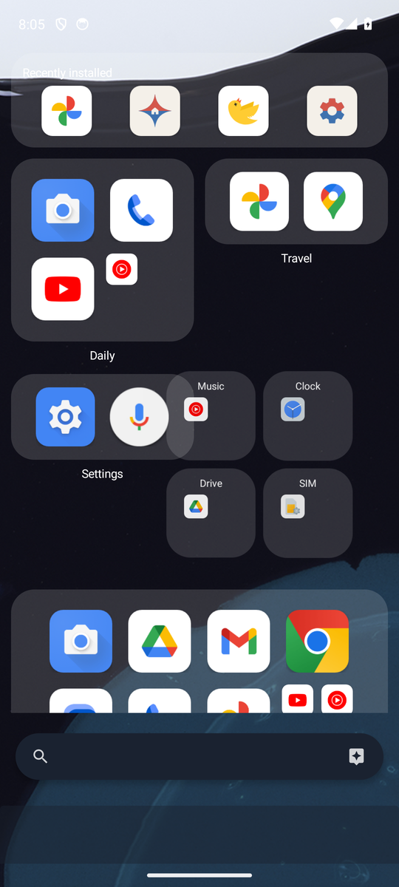
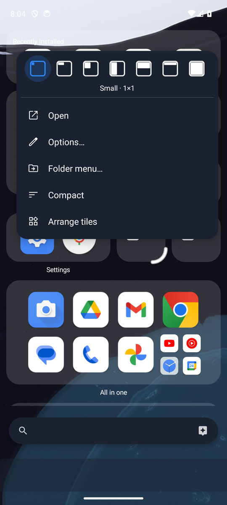
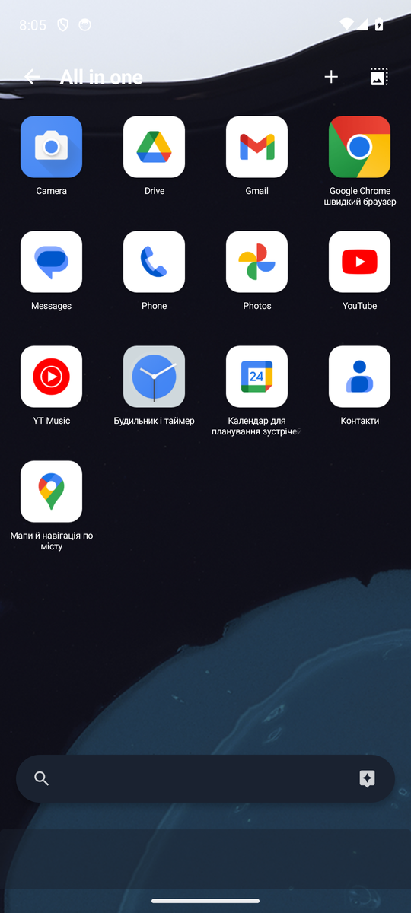
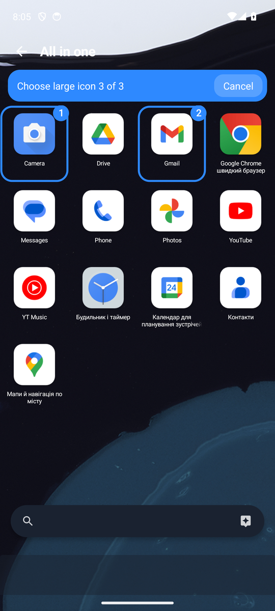

# Supernova · Categories fork 🌌

**🇺🇦 [Українською](#-українською) · 🇷🇺 [По-русски](#-по-русски) · 🇬🇧 [In English](#-in-english)**

    

*Mosaic · block drag · tile menu · open category · large icons*

**No ads. No tracking. Open source.** AGPL-3.0 · Telegram **[@Bezeza](https://t.me/Bezeza)** · 💛 **[Monobank jar](https://send.monobank.ua/jar/8Hqt4ZL4oD)**

---

## 🇺🇦 Українською

Це форк чудового лаунчера [Supernova](https://github.com/tanujnotes/Supernova) (база: **v0.2.9**). Я зробив з меню застосунків те, чого мені не вистачало: **категорії-плитки, які можна розкласти як мозаїку**, як на твоїй особистій дошці, а не нудний список.

### ✨ Що тут нового
- 🧩 **Мозаїка плиток.** Сітка з 4 колонок, кожна плитка у своїй клітинці. **7 розмірів:** 1×1, півплитка 2×1, 2×2, висока 2×4, широка 4×2, смуга 4×1 і величезна 4×4.
- 🖐 **Тягни як хочеш.** Довге натискання відкриває меню з розмірами, тягни плитку в будь-яке місце, а сусіди зсуваються самі. **Чотири малі плитки квадратом їдуть разом, як одна велика.** «Ущільнити» прибирає дірки.
- 🔥 **Нещодавно встановлені** у трьох розмірах: 4×1, 2×2, 4×2.
- 📐 **Відкрита категорія більше не «дрібна».** Налаштування «Колонки в категорії»: **Авто** (≤ 9 застосунків це 3 великі колонки, 10–16 це 4), як у меню, 3, 4 або 5. Мало застосунків? Блок просто стає по центру.
- 🎯 **Великі іконки без загадок.** Режим вибору видно: яскрава смуга «Оберіть велику іконку 1 з 3», рамка й номер на обраних, повторний тап знімає вибір.
- 🏠 **Сторінка категорій на робочому столі**, 20 значків категорій, пошук, що розуміє «не ту розкладку» (*вайбер* знайде Viber).
- 🌍 **Українська й російська мови** з коробки.

### 📲 Встановлення
Готових релізів у цьому репозиторії ще немає. Хочеш збірку, пиши в Telegram **[@Bezeza](https://t.me/Bezeza)**, або збери сам: `./gradlew assembleRelease` (потрібен JDK 17 і Android SDK).

### 💛 Підтримати
Форк безкоштовний і без реклами. Якщо він тобі став у пригоді, можна кинути на каву й розвиток у [банку Monobank](https://send.monobank.ua/jar/8Hqt4ZL4oD). Дякую, це справді мотивує!

### 🤝 Подяка й ліцензія
Усе найкраще в основі, це робота [@tanujnotes](https://github.com/tanujnotes) і спільноти Supernova. Форк тримається поруч з оригіналом (синхронізація з upstream, окремий код у пакеті `fork`). Ліцензія **AGPL-3.0**, див. [LICENSE](LICENSE). Як усе влаштовано: [FORK.md](FORK.md).

---

## 🇷🇺 По-русски

Это форк отличного лаунчера [Supernova](https://github.com/tanujnotes/Supernova) (база: **v0.2.9**). Я сделал из меню приложений то, чего мне не хватало: **категории-плитки, которые можно разложить мозаикой**, как на личной доске, а не скучный список.

### ✨ Что нового
- 🧩 **Мозаика плиток.** Сетка из 4 колонок, у каждой плитки своя клетка. **7 размеров:** 1×1, полуплитка 2×1, 2×2, высокая 2×4, широкая 4×2, полоса 4×1 и огромная 4×4.
- 🖐 **Тащи как хочешь.** Долгое нажатие открывает меню с размерами, тащи плитку куда угодно, а соседи сдвигаются сами. **Четыре маленькие плитки квадратом едут вместе, как одна большая.** «Уплотнить» убирает дырки.
- 🔥 **Недавно установленные** в трёх размерах: 4×1, 2×2, 4×2.
- 📐 **Открытая категория больше не «мелкая».** Настройка «Колонки в категории»: **Авто** (≤ 9 приложений это 3 крупные колонки, 10–16 это 4), как в меню, 3, 4 или 5. Приложений мало? Блок просто встаёт по центру.
- 🎯 **Большие иконки без загадок.** Режим выбора виден: яркая полоса «Выберите большую иконку 1 из 3», рамка и номер на выбранных, повторное нажатие снимает выбор.
- 🏠 **Страница категорий на рабочем столе**, 20 значков категорий, поиск, который понимает «не ту раскладку» (*вайбер* найдёт Viber).
- 🌍 **Украинский и русский языки** из коробки.

### 📲 Установка
Готовых релизов в этом репозитории пока нет. Нужна сборка: пишите в Telegram **[@Bezeza](https://t.me/Bezeza)**, или соберите сами: `./gradlew assembleRelease` (нужны JDK 17 и Android SDK).

### 💛 Поддержать
Форк бесплатный и без рекламы. Если он вам пригодился, можно бросить на кофе и развитие в [банку Monobank](https://send.monobank.ua/jar/8Hqt4ZL4oD). Спасибо, это правда мотивирует!

### 🤝 Благодарность и лицензия
Всё лучшее в основе, это работа [@tanujnotes](https://github.com/tanujnotes) и сообщества Supernova. Форк держится рядом с оригиналом (синхронизация с upstream, отдельный код в пакете `fork`). Лицензия **AGPL-3.0**, см. [LICENSE](LICENSE). Как всё устроено: [FORK.md](FORK.md).

---

## 🇬🇧 In English

A fork of the wonderful [Supernova](https://github.com/tanujnotes/Supernova) launcher (based on **v0.2.9**). I turned the app drawer into what I always missed: **category tiles you can lay out as a mosaic**, like your own board, instead of a boring list.

### ✨ What's new
- 🧩 **A mosaic of tiles.** A 4-column grid, every tile in its own cell. **7 sizes:** 1×1, half 2×1, 2×2, tall 2×4, wide 4×2, strip 4×1 and a huge 4×4.
- 🖐 **Drag it your way.** A long press opens a menu with the sizes, drag a tile anywhere and its neighbours make way. **Four small tiles in a square move together as one big one.** "Compact" closes the gaps.
- 🔥 **Recently installed** in three sizes: 4×1, 2×2, 4×2.
- 📐 **An open category is no longer tiny.** The "Columns in a category" setting: **Auto** (≤ 9 apps get 3 big columns, 10–16 get 4), like the menu, 3, 4 or 5. Only a few apps? The block simply centres itself.
- 🎯 **Large icons, no guessing.** The picking mode shows itself: a bright "Choose large icon 1 of 3" bar, a frame and a number on the chosen apps, a second tap takes one back.
- 🏠 **A categories page on the home screen**, 20 category glyphs, search that understands the wrong keyboard layout (*вайбер* finds Viber).
- 🌍 **Ukrainian and Russian** out of the box.

### 📲 Install
There are no ready releases in this repository yet. Want a build? Message **[@Bezeza](https://t.me/Bezeza)** on Telegram, or build it yourself: `./gradlew assembleRelease` (needs JDK 17 and the Android SDK).

### 💛 Support
The fork is free and ad-free. If it helped you, you can toss in for coffee and further work via a [Monobank jar](https://send.monobank.ua/jar/8Hqt4ZL4oD). Thank you, it really keeps me going!

### 🤝 Credits & license
The best of it is the base, the work of [@tanujnotes](https://github.com/tanujnotes) and the Supernova community. This fork stays close to the original (synced with upstream, its own code in the `fork` package). License **AGPL-3.0**, see [LICENSE](LICENSE). How it is built: [FORK.md](FORK.md).

⭐ If you like it, star the repo. · Якщо подобається, постав ⭐

